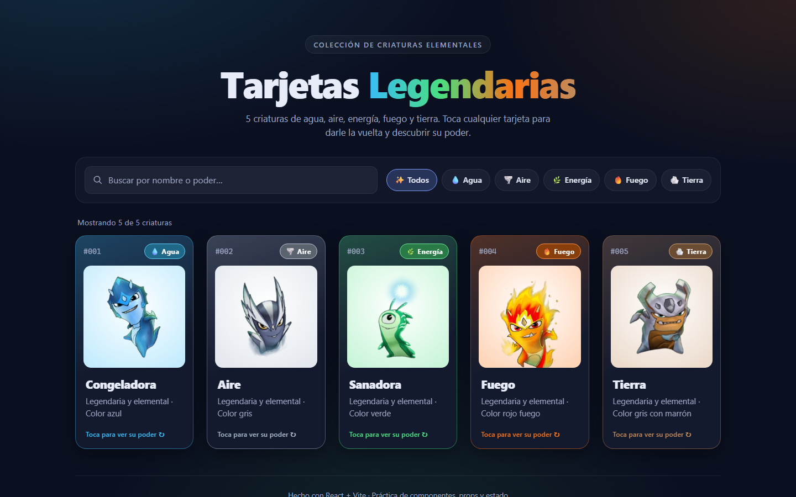

# 🃏 Tarjetas Legendarias

Colección interactiva de tarjetas de **criaturas legendarias y elementales**: agua, aire, energía, fuego y tierra. Cada tarjeta se voltea para revelar el poder de la criatura. Es un proyecto de práctica con **React + Vite** centrado en componentes, props y estado.

[](https://alberto-inky.vercel.app)



## ✨ Funcionalidades

- 🔄 **Tarjetas que se voltean** en 3D: al frente la criatura y atrás su poder.
- 🎨 **Insignias y acentos por elemento**: cada criatura usa el color de su elemento.
- 🔎 **Buscador** por nombre, poder o color (no distingue tildes ni mayúsculas).
- 🧩 **Filtro por elemento** con chips (Agua, Aire, Energía, Fuego, Tierra).
- 📱 **Diseño responsive**: la cuadrícula se adapta a móvil, tablet y escritorio.
- ♿ **Accesible**: tarjetas operables con teclado (Enter o Espacio), foco visible, textos alternativos y soporte para `prefers-reduced-motion`.
- 🗂️ **Datos separados de la vista**: las criaturas viven en `src/data/criaturas.js` y se renderizan con `map`.

## 🛠️ Tecnologías


## 🚀 Cómo ejecutarlo

Requisitos: **Node.js 24**.

```bash
git clone https://github.com/alejo234506/Alberto.git
cd Alberto
npm install
npm run dev       # servidor de desarrollo en http://localhost:5173
```

Otros scripts:

```bash
npm run lint      # revisa el código con ESLint
npm run build     # genera la versión de producción en dist/
npm run preview   # sirve localmente la versión de producción
```

## 📁 Estructura

```
src/
├── App.jsx              # Hero, buscador, filtros y cuadrícula
├── App.css              # Estilos (tema oscuro, tarjetas 3D, responsive)
├── components/
│   └── Tarjeta.jsx      # Tarjeta que se voltea
├── data/
│   └── criaturas.js     # Datos de las criaturas y de los elementos
└── imagenes/            # Ilustraciones .webp
```

### ➕ Agregar una criatura

1. Copia las dos imágenes (frente y poder) en `src/imagenes/`.
2. Impórtalas en `src/data/criaturas.js` y agrega un objeto al arreglo `CRIATURAS`:

```js
{
  id: 6,
  nombre: 'Relámpago',
  elemento: 'energia',      // agua | aire | energia | fuego | tierra
  color: 'Amarillo',
  tipo: 'Legendaria y elemental',
  imagen: relampago,
  imagenPoder: relampagoPoder,
  descripcion: 'Lanza rayos a toda velocidad.',
}
```

## 🌐 Despliegue

El proyecto se despliega automáticamente en **Vercel** con cada push a `master`:
👉 https://alberto-inky.vercel.app
